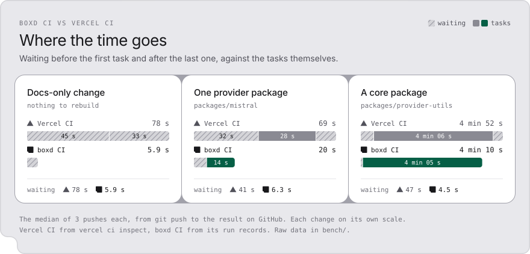
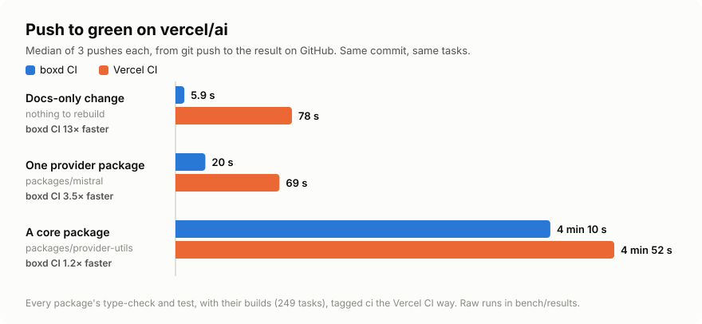
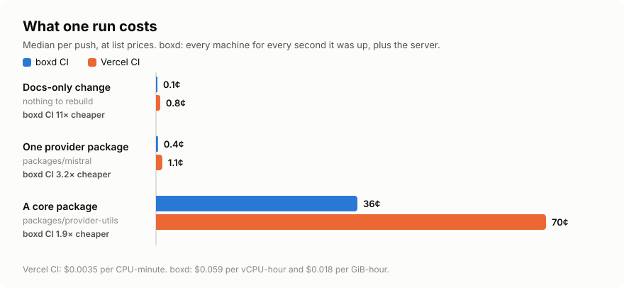
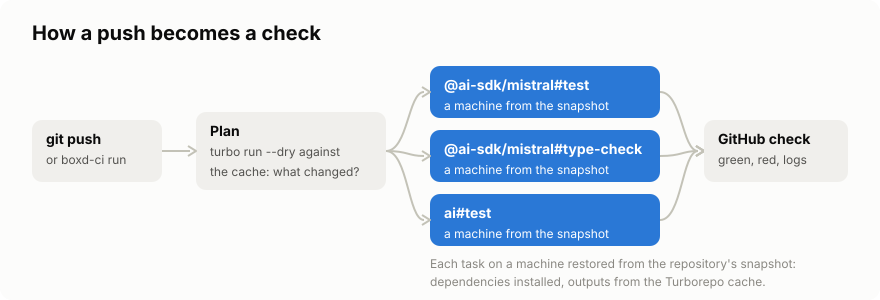
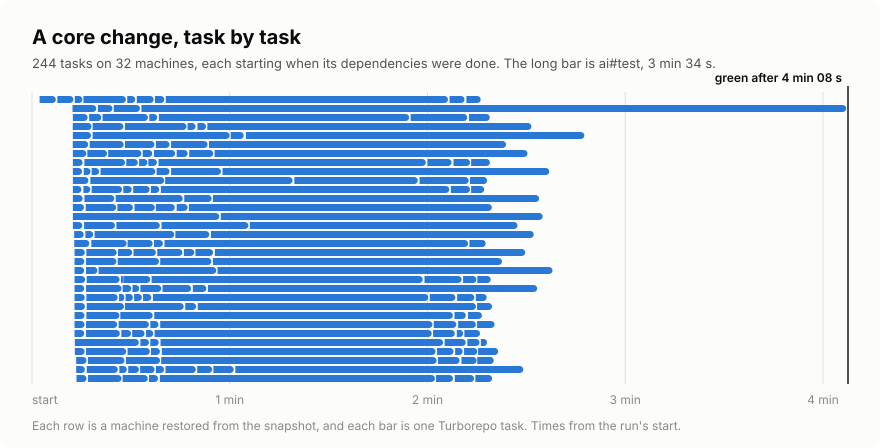

<p align="center">
  <picture>
    <source media="(prefers-color-scheme: dark)" srcset="assets/time-dark.svg">
    
  </picture>
</p>

# boxd CI

Open source CI for Turborepo monorepos. On [`vercel/ai`](https://github.com/vercel/ai) it gets a push to
green **13× faster than Vercel CI** for a docs change, **3.5×** for one package and **1.2×** for a core
change.

### Why it's faster

- **It starts in seconds.** Every machine boots from a snapshot with your repository and `node_modules`
  already in place, so the first task starts seconds after the push. Vercel CI clones and installs on
  every push first, 27 to 32 s before its first task.
- **It's done when the last task is.** The check completes the moment the last task ends. Vercel CI's
  result reaches GitHub 10 to 33 s later.
- **Its machines are warm.** A machine boots with the files the last build read already in memory and
  the Turborepo cache on its own disk, and the machine that built a package runs that package's next
  task. On the one-package change the same tasks took half as long.

```bash
boxd auth login                     # once, signs you in to boxd
npx github:azin-tech/boxd-ci run    # CI on your working copy, now
npx github:azin-tech/boxd-ci init   # a boxd-ci check on every push
```

The `ci` tags in your `turbo.json` from Vercel CI work as they are, and a repository without them runs
its usual checks: lint, type checks and tests. See [what you need](#what-you-need).

<p align="center">
  <picture>
    <source media="(prefers-color-scheme: dark)" srcset="assets/demo-dark.svg">
    
  </picture>
</p>

## Results

The same `vercel/ai` code (commit `dfed8e8` with the `ci` tags) and the same 249 tasks: every package's
`type-check` and `test`, with their builds. Median of three pushes each, from `git push` to the result
on GitHub.

| Push to green on vercel/ai | boxd CI | Vercel CI | | Cost, boxd CI | Cost, Vercel CI |
|---|---|---|---|---|---|
| Docs-only change | **5.9 s** | 78 s | 13× faster | 0.4¢ | 0.8¢ |
| One provider package | **20 s** | 69 s | 3.5× faster | 0.6¢ | 1.1¢ |
| A core package | **4 min 10 s** | 4 min 52 s | 1.2× faster | 29¢ | 70¢ |

<p align="center">
  <picture>
    <source media="(prefers-color-scheme: dark)" srcset="assets/race-dark.svg">
    
  </picture>
</p>

### Where the time goes

Each run splits at its first task and its last, from Vercel CI's own run records (`vercel ci inspect`)
and boxd CI's, both in [`bench/`](bench/README.md).

- **Docs-only.** Nothing had to run, and Vercel CI still took 78 s: 45 s to find every result in the
  cache, and 33 s more before GitHub had the result. boxd CI took 5.9 s.
- **One package.** Vercel CI waited 32 s for its first task, ran the three tasks in 28 s, and reported
  10 s later. boxd CI started the first task 6.3 s after the push and ran the same three tasks in 14 s,
  each task on 2 CPUs on both platforms.
- **Core package.** The tasks took 4 min 06 s on Vercel CI and 4 min 05 s on boxd CI, so the 43 s
  between the two runs is all waiting: 47 s on Vercel CI, 4.5 s on boxd CI.

Every Vercel CI task runs on its own new compute instance, after a bootstrap machine has cloned the
repository and installed its dependencies. A boxd machine is restored from a snapshot with its memory,
plans with Turborepo, and starts the first task. GitHub's own delivery of the push is in both times.

<p align="center">
  <picture>
    <source media="(prefers-color-scheme: dark)" srcset="assets/cost-dark.svg">
    
  </picture>
</p>

The cost is at list prices. boxd CI counts every task machine for every second it was up, with all its
RAM in use (boxd bills the RAM in use, so this is an upper bound), and the server for the run plus the
minute it stays awake after. It leaves out snapshot storage, kept machines of failed tasks (hibernated,
disk only), the promotion after a green push to the default branch, and the server while it sleeps
between pushes (about 1.7¢ an hour for the RAM it holds, until it goes to disk after four idle hours).

Both sides had a warm cache for what a push did not touch. A boxd snapshot also carries a local
Turborepo cache from its last promotion, so a boxd machine restores a dependency's outputs from its own
disk. Both ran tasks on 2 CPUs, a boxd machine with 8 GiB of memory and a Vercel CI task with 4 GB. The
two lanes ran on consecutive days, in private copies of the repository. Every run, the method and the
other caveats are in [`bench/`](bench/README.md).

### The case Vercel CI won

The first boxd prototype ran CI as one machine plus a fixed set of test shards, each restored from a
snapshot, with the Turborepo cache. With 16 shards it won the small changes and lost the core change
to Vercel CI, since a fixed set of shards waits for its slowest one. Doubling to 32 shards beat Vercel
CI by 14 seconds, within the spread of three runs on either side, at a higher cost than 16. Scheduling
each Turborepo task the moment its dependencies finish, the way Vercel CI does, is what boxd CI adds.

| A core change, push to green | median |
|---|---|
| Vercel CI | 4 min 52 s |
| boxd prototype, 16 shards on snapshots, with the cache | 5 min 28 s |
| boxd prototype, 32 shards | 4 min 39 s |
| **boxd CI, scheduled per task** | **4 min 10 s** |

The core change is bound by one task. `ai#test` took 3 min 34 s on a 2 vCPU boxd machine, and the
longest task of a Vercel CI run took a median of 3 min 17 s on 2 CPUs. Tagging `ai#test` with
`ci:cpus:4` gives it a bigger machine on either platform.

## Why this exists

Vercel CI launched with the right model for monorepos. Turborepo knows the task graph, so every task
starts as soon as its dependencies finish, and is skipped when the cache already has its result. That
model is the reason this repository exists.

On Vercel CI every push starts with bootstrapping. A separate machine clones the repository and
installs its dependencies, and the task machines start after it. On `vercel/ai` that took a median of
27 s per push before the first task ran. Vercel CI is also closed source and runs on Vercel only.

boxd CI keeps the model and the configuration and changes what a machine starts from. A boxd
machine is restored from a snapshot with its memory and disk, so the repository is checked out and
`node_modules` is in place the moment it boots. The install happened once, when the snapshot was
saved. The Turborepo cache server runs next to the machines, on your own account, and the whole
thing is a few thousand lines of TypeScript under the MIT license.

## How it works

<p align="center">
  <picture>
    <source media="(prefers-color-scheme: dark)" srcset="assets/how-dark.svg">
    
  </picture>
</p>

1. **Plan.** A machine restored from the snapshot checks out the commit and asks Turborepo for the
   graph of the tasks CI runs, with `--dry` against the cache. Tasks whose result is in the cache are
   done before anything starts. When the commit's dependency files differ from the snapshot's, this
   machine installs once and is saved as a snapshot for the run's other machines. A push to the
   default branch keeps that snapshot for later pushes with the same files. A branch deletes its own
   when the run ends.
2. **Schedule.** Every remaining task starts the moment its dependencies are done, on a machine
   restored from the snapshot, the most urgent chain first, up to 32 machines at once. A machine that
   finishes takes the next ready task, and machines for the next wave start while the current one is
   still running. Tasks that took under ten seconds last time can share a machine.
3. **Run.** Each machine runs `turbo run <package>#<task>` with the remote cache. Turborepo restores the
   outputs of the task's dependencies and uploads the task's own. The declared outputs are deleted
   first, so every file in `dist` comes from this run or from the cache.
4. **Report.** A `boxd-ci` check on the commit shows every task that ran, its time and its machine, and
   the end of every failed log. A failed task's machine is hibernated and kept for a day, as the task
   left it, so `boxd connect` lands on its disk. A run keeps at most three.
5. **Promote.** After a green push to the default branch, a new snapshot of that commit is saved,
   with every task's output in its local Turborepo cache, and runs start from it. The one before is
   deleted six hours later, after any run still restoring from it.

<p align="center">
  <picture>
    <source media="(prefers-color-scheme: dark)" srcset="assets/timeline-dark.svg">
    
  </picture>
</p>

## Compared

| | boxd CI | Vercel CI | GitHub Actions | Blacksmith |
|---|---|---|---|---|
| Source | open, MIT | closed | runner open, service closed | closed |
| Config | `turbo.json` tags | `turbo.json` tags | workflow YAML | workflow YAML |
| Unit of work | one Turborepo task, on a pool of snapshot machines | one Turborepo task per container | one job per runner | one job per runner |
| A task machine starts from | a snapshot with dependencies installed | a container, after a bootstrap that clones and installs | a fresh image | a fresh image with a cache disk |
| Turborepo cache | on your boxd account | Vercel's | bring your own | bring your own |
| A failed task's machine | kept for 24 hours, `boxd connect` into it | its logs, in the dashboard, CLI and MCP | ends with the job | SSH while the job runs, kept longer by a sleep step |
| CLI for agents | `boxd-ci run`, `logs`, `grep`, all with `--json` | `vercel ci`, Vercel MCP, the REST API | `gh run` | `gh run` |
| Public repositories | yes | not yet (beta) | yes | yes |
| Runs on | your boxd account | Vercel | GitHub | Blacksmith |

Timings and prices in this README are for boxd CI and Vercel CI only. Those two are the ones we ran
on the same repository and the same tasks.

## Coming from Vercel CI

The `ci` tags in your `turbo.json` work as they are:

| In turbo.json | What it does |
|---|---|
| `"tags": ["ci"]` on a task | the task runs in CI, in every package that has the script |
| `"tags": ["ci"]` in a package's `turbo.json` | the task runs in CI for that package |
| `"tags": ["!ci"]` in a package's `turbo.json` | that package opts out |
| `"tags": ["ci", "ci:cpus:4"]` | the task runs on a 4 vCPU machine (1, 2, 4 or 8, rounded up) |
| `"tags": ["$TURBO_EXTENDS$", "ci:cpus:4"]` in a package | keeps the root's tags and adds to them |
| `"tags": ["ci", "ci:os:ubuntu"]` | accepted and ignored, since every boxd machine runs Ubuntu |

Dependencies run too, the way Turborepo composes them. A `test` that depends on `^build` gets its
builds first. Without a single `ci` tag, boxd CI runs the usual checks your `turbo.json` defines (`lint`,
`type-check`, `typecheck`, `check-types`, `types`, `test`, `test:unit`), so it works before you tag
anything and on any turbo from 2.4.

What does not carry over:

- `vercel.json`, including its bootstrapping settings. boxd CI installs with the package manager your
  lockfile names, on the Node.js version in `.nvmrc` or `.node-version`.
- Vercel's environment variables. Secrets come from `boxd-ci secret set` (below).
- Tasks that depend on a Vercel deployment (`web#deployment`) or ask for Vercel's OIDC tokens
  (`ci:oidc:*`). They are left out of the run, with a warning.
- `ci:cpus` above 8. Those tasks run on 8 vCPU.

Every task runs with `CI=1` and the remote cache settings.

### Secrets

```bash
boxd-ci secret set NPM_TOKEN        # typed hidden, or piped in: printf %s "$TOKEN" | boxd-ci secret set NPM_TOKEN
```

The value becomes a boxd secret that reaches boxd-ci's machines only, and `.boxd-ci.json` names it.
Commit that file. Turborepo passes a variable to a task only when `turbo.json` lists it, so add the name
to the task's `env` (or to `globalEnv`), as on Vercel CI. Installs get the secrets too, so a private
registry's token works in `.npmrc`. `boxd-ci secret ls` shows which names are set, and `rm` deletes one.

## What you need

- a [boxd](https://boxd.sh) account and the [boxd CLI](https://docs.boxd.sh)
- Node.js 20 or newer
- a Turborepo repository on github.com, with `turbo` 2.4 or newer as a dev dependency (2.11 or newer to
  use `ci` tags)
- for a check on every push, the boxd GitHub App installed for the repository (Integrations, in the
  boxd console)
- for a private repository, a `gh` login, used once to clone it for the first snapshot

## Commands

| Command | |
|---|---|
| `boxd-ci run` | CI on your working copy: tracked changes and new files that git does not ignore, as a patch on the snapshot's commit. `--max-machines <n>` caps the run. |
| `boxd-ci init` | starts the server, builds the first snapshot, installs the push automation and says what CI runs. `--rebuild` builds the snapshot again, `--no-github` skips the automation, `--dry-run` only lists the steps. |
| `boxd-ci ls` | the latest runs of this repository (`--limit <n>`, 15 by default) |
| `boxd-ci logs [run]` | a run's summary and its failed logs, by run id or commit hash. `--task <id>` shows one task, `--failed` every failed one. |
| `boxd-ci grep <text>` | every matching line in the end of each task log (the last 20 kB) of the last 20 runs (`--runs <n>`) |
| `boxd-ci doctor` | checks the sign-in, server, cache, snapshot, automation and GitHub App. `--sweep` deletes machines a finished run left behind. |
| `boxd-ci secret set NAME` | a secret for tasks and installs. Also `secret ls` and `secret rm NAME`. |

Every command takes `--json`, `--org <org>` and `--server <name>`. Without `boxd auth login`, set
`BOXD_API_KEY`. `skills/boxd-ci/SKILL.md` teaches Claude Code and Codex to run CI before they push and
to read a red run. Copy it into `.claude/skills/` or your agent's skills folder.

`run` needs nothing on GitHub beyond the repository. It is the quickest way to try boxd CI, and the way
an agent checks its own change before it pushes.

## What runs on your account

| | What | When it costs |
|---|---|---|
| `boxd-ci-server` | the Turborepo remote cache and the run history, 2 vCPU, 8 GiB | while awake. Asleep it bills the RAM it holds (about 1.7¢ an hour) and its disk, and after four idle hours only its disk. A push wakes it. |
| `bci-<repo>-<commit>` | the snapshot runs start from, named after its commit | storage |
| `bci-<repo>-deps-*` | dependency snapshots made by pushes to the default branch, for lockfiles that differ from the snapshot's | storage, deleted after a week |
| `bci-<repo>-dev-*` | dependency snapshots made by `boxd-ci run` | storage, deleted after a week |
| `bci-<repo>-run-*` | a branch push's dependency snapshot | storage, deleted when its run ends |
| `bci-<commit>-*` | task machines | for the seconds they run, then deleted at the end of the run |
| `bci-<commit>-*`, hibernated | the machines of failed tasks, at most three per run | disk only, for 24 hours. Connecting wakes one, and 15 idle minutes send it back to disk. |

Every task machine is created with a one-hour delete-after timer, set again while its run goes on, so a
run that dies halfway leaves nothing running for long. `boxd-ci doctor --sweep` cleans up sooner.

## Security

boxd CI is for repositories where you trust everyone who can push a branch.

- **The cache is shared.** Every task gets the cache token, and every run of a repository reads and
  writes one cache namespace. A branch could upload a result under the hash of a task on the default
  branch, which would then restore it instead of running the task. Pull requests from forks are not
  run.
- **Task machines are isolated.** Nothing else on your boxd account can reach them, and they hold no
  boxd credentials.
- **The GitHub token.** A machine that fetches a commit gets a GitHub App installation token for that
  one command, as a header for github.com only. It reaches git through the environment, on no command
  line, and git runs with hooks off. The token can read every repository the boxd GitHub App can, for
  up to an hour. A machine restored from a snapshot that a branch's install made never gets one. It
  checks out a commit it already has.
- **Secrets** from `boxd-ci secret set` reach boxd-ci's machines only, and every task of a run can read
  them, as in any CI. Pushes take the list of names from the default branch, so a branch cannot ask
  for more.
- **Logs.** The cache token is replaced before a log is stored or posted, and terminal control
  sequences are removed. Other secrets a task prints stay in its log.
- **Files on the server** that hold the cache token and the run history are readable by their owner
  only.
- The first snapshot of a private repository clones it with your `gh` login, once, on a machine that is
  deleted afterwards.

## Teams

The server belongs to whoever ran `init`. To give everyone in the boxd org the same cache and run
history, share it once:

```bash
boxd machine share boxd-ci-server
```

Everyone in the org can then use the server as its owner does: read the cache token, and run commands
on it, where the push automation runs as root. That fits the trust model above.

## Configuration

Optional, in `.boxd-ci.json` at the repository root. `init` writes the org, and `boxd-ci secret set`
the secrets.

```jsonc
{
  "org": "acme",              // the boxd org that runs CI (default: your boxd CLI's active org)
  "server": "boxd-ci-server", // the server machine
  "maxMachines": 32,          // machines one run may use at once (1 to 256)
  "packSeconds": 10,          // tasks shorter than this share a machine (0: every task alone)
  "secrets": ["NPM_TOKEN"]    // boxd secrets every machine of a run gets
}
```

The run settings are read at the commit being tested, so they change with your code. Pushes take
`secrets` from the default branch.

## Limits

- Repositories on github.com, Turborepo monorepos, and pushes to the repository itself. A pull request
  gets the check of its head commit. GitHub's Re-run button does nothing yet, so push again.
- Node.js projects with npm, pnpm, Yarn (with `node_modules`, not Plug'n'Play) or Bun. Anything else a
  task needs (system packages, browsers) can come from a `postinstall` script, since the whole machine
  goes into the snapshot.
- Submodules are checked out. Git LFS files are not fetched.
- Machines are Linux, 1 to 8 vCPU. A task that needs more gets 8.
- The cache lives on one server per account.

## Development

```bash
npm install
npm run check       # lint, types, 200+ tests
npm run build       # dist/cli.mjs, dist/planner.mjs, dist/boxd-ci.run.mjs
npm run charts      # redraw assets/ from bench/results
```

`src/core` is the pure part: tags, graph, scheduler, records, reports. `src/boxd` talks to boxd:
machines, the server, snapshots. `src/pipeline.ts` is one run, shared by the CLI and the push
automation in `src/automation`. This repository is one package, not a Turborepo monorepo, so its own
checks run on GitHub Actions.

## License

MIT
