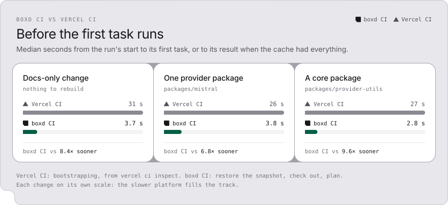

<p align="center">
  <picture>
    <source media="(prefers-color-scheme: dark)" srcset="assets/race-dark.svg">
    
  </picture>
</p>

# boxd CI

Open source CI for Turborepo monorepos. Every task runs on its own machine, restored from a snapshot
of your repository with its dependencies already installed. Results come from a Turborepo remote
cache on your own boxd account, so a push only runs what it changed.

Your `turbo.json` from Vercel CI works as it is.

You need a [boxd](https://boxd.sh) account, Node.js 20 or newer, and a Turborepo repository on GitHub
with `turbo` 2.11 or newer as a dev dependency.

```bash
boxd auth login                     # once, signs you in to boxd
npx github:azin-tech/boxd-ci run    # CI on your working copy, now
npx github:azin-tech/boxd-ci init   # a boxd-ci check on every push
```

<p align="center">
  <picture>
    <source media="(prefers-color-scheme: dark)" srcset="assets/demo-dark.svg">
    
  </picture>
</p>

## Results

The same [`vercel/ai`](https://github.com/vercel/ai) code (commit `dfed8e8` with the `ci` tags) and
the same 249 tasks: `type-check` and `test` of 84 packages, with their builds. Median of three pushes
each, from `git push` to the result on GitHub.

| Push to green on vercel/ai | boxd CI | Vercel CI | | Cost, boxd CI | Cost, Vercel CI |
|---|---|---|---|---|---|
| Docs-only change | **5.9 s** | 78 s | 13× faster | 0.1¢ | 0.8¢ |
| One provider package | **20 s** | 69 s | 3.5× faster | 0.4¢ | 1.1¢ |
| A core package | **4 min 10 s** | 4 min 52 s | 1.2× faster | 36¢ | 70¢ |

<p align="center">
  <picture>
    <source media="(prefers-color-scheme: dark)" srcset="assets/cost-dark.svg">
    
  </picture>
</p>

Most of the difference on small changes is the start. A boxd CI run started its first task 3.8 s
after it began, the median of the leaf runs, for restoring the snapshot, checking out and planning
with Turborepo. Vercel CI spent a median of 27 s bootstrapping before its first task.

<p align="center">
  <picture>
    <source media="(prefers-color-scheme: dark)" srcset="assets/first-dark.svg">
    
  </picture>
</p>

The cost counts every task machine for every second it was up and the server for the length of the
run. It leaves out snapshot storage, kept machines of failed tasks (hibernated, disk only) and the
promotion after a green push to the default branch, which these branch pushes did not trigger. Every
run, the method and the caveats are in [`bench/`](bench/README.md).

### The case Vercel CI won

The first boxd prototype ran CI as one machine plus a fixed set of test shards, each restored from a
snapshot, with the Turborepo cache. With 16 shards it won the small changes and lost the core change
to Vercel CI, since a fixed set of shards waits for its slowest one. Doubling to 32 shards beat Vercel
CI by 13 seconds, at a higher cost than 16. Scheduling every Turborepo task on its own machine, the
way Vercel CI does, is what boxd CI adds.

| A core change, push to green | median |
|---|---|
| Vercel CI | 4 min 52 s |
| boxd prototype, 16 shards on snapshots, with the cache | 5 min 28 s |
| boxd prototype, 32 shards | 4 min 39 s |
| **boxd CI, one machine per task** | **4 min 10 s** |

The core change is bound by one task. `ai#test` took 3 min 34 s on a 2 vCPU boxd machine, and the
longest task of a Vercel CI run took a median of 3 min 17 s on 2 CPUs. Tagging `ai#test` with
`ci:cpus:4` gives it a bigger machine on either platform.

## Why this exists

Vercel CI launched with the right model for monorepos. Turborepo knows the task graph, so every task
gets its own machine, starts as soon as its dependencies finish, and is skipped when the cache already
has its result. That model is the reason this repository exists.

Every push starts with bootstrapping. A separate machine clones the repository and installs its
dependencies, and the task machines start after it. On `vercel/ai` that took a median of 27 s per
push before the first task ran. Vercel CI is also closed source and runs on Vercel only.

boxd CI keeps the model and the configuration and changes what a machine starts from. A boxd
machine is restored from a snapshot with its memory and disk, so the repository is checked out and
`node_modules` is in place the moment it boots. The install happened once, when the snapshot was
saved. The Turborepo cache server runs next to the machines, on your own account, and the whole
thing is a few thousand lines of TypeScript under the MIT license.

## How it works

<p align="center">
  <picture>
    <source media="(prefers-color-scheme: dark)" srcset="assets/how-dark.svg">
    
  </picture>
</p>

1. **Plan.** A machine restored from the snapshot checks out the commit and asks Turborepo for the
   graph of every task tagged `ci`, with `--dry` against the remote cache. Tasks whose result is in
   the cache are done before anything starts. When the commit's lockfile differs from the snapshot's,
   this machine installs once and is saved as a snapshot for the run's other machines, and for the
   next push with the same lockfile.
2. **Schedule.** Every remaining task starts on its own machine the moment its dependencies are done,
   the most urgent chain first, up to 32 machines at once. A machine that finishes takes the next
   ready task, and machines for the next wave start while the current one is still running. Tasks
   that took under ten seconds last time can share a machine.
3. **Run.** Each machine runs `turbo run <package>#<task>` with the remote cache. Turborepo restores the
   outputs of the task's dependencies and uploads the task's own. The declared outputs are deleted
   first, so every file in `dist` comes from this run or from the cache.
4. **Report.** A `boxd-ci` check on the commit shows every task that ran, its time and its machine, and
   the end of every failed log. A failed task's machine is hibernated and kept for a day, as the task
   left it, so `boxd connect` lands on its disk. A run keeps at most three.
5. **Promote.** After a green push to the default branch, a new snapshot of that commit is saved,
   with every task's output in its local Turborepo cache, and runs start from it. The one before is
   deleted six hours later, after any run still restoring from it.

<p align="center">
  <picture>
    <source media="(prefers-color-scheme: dark)" srcset="assets/timeline-dark.svg">
    
  </picture>
</p>

## Compared

| | boxd CI | Vercel CI | GitHub Actions | Blacksmith |
|---|---|---|---|---|
| Source | open, MIT | closed | runner open, service closed | closed |
| Config | `turbo.json` tags | `turbo.json` tags | workflow YAML | workflow YAML |
| Unit of work | one Turborepo task per machine | one Turborepo task per machine | one job per runner | one job per runner |
| A task machine starts from | a snapshot with dependencies installed | a container, after a bootstrap that clones and installs | a fresh image | a fresh image with a cache disk |
| Turborepo cache | on your boxd account | Vercel's | bring your own | bring your own |
| A failed task's machine | kept for 24 hours, `boxd connect` into it | gone | gone | gone |
| CLI for agents | `boxd-ci run`, `logs`, `grep`, all with `--json` | `vercel ci` | `gh run` | `gh run` |
| Runs on | your boxd account | Vercel | GitHub | Blacksmith |

Timings and prices in this README are for boxd CI and Vercel CI only. Those two are the ones we ran
on the same repository and the same tasks.

## Coming from Vercel CI

Your `turbo.json` already works. boxd CI reads the same tags:

| In turbo.json | What it does |
|---|---|
| `"tags": ["ci"]` on a task | the task runs in CI, in every package that has the script |
| `"tags": ["ci"]` in a package's `turbo.json` | the task runs in CI for that package |
| `"tags": ["!ci"]` in a package's `turbo.json` | that package opts out |
| `"tags": ["ci", "ci:cpus:4"]` | the task runs on a 4 vCPU machine (1, 2, 4 or 8, rounded up) |
| `"tags": ["$TURBO_EXTENDS$", "ci:cpus:4"]` in a package | keeps the root's tags and adds to them |
| `"tags": ["ci", "ci:os:linux"]` | accepted, and every boxd machine is Linux |

Dependencies run too, the way Turborepo composes them. A `test` that depends on `^build` gets its
builds first. `boxd-ci init` tags `lint`, `type-check` and `test` for you in a repository without any
`ci` tag, and leaves an existing Vercel CI setup alone.

Tasks run with `CI=1` and the remote cache settings. Environment variables and secrets for tasks are
next on the roadmap.

## Commands

| Command | |
|---|---|
| `boxd-ci run` | CI on your working copy: tracked changes and new files that git does not ignore, as a patch on the snapshot's commit |
| `boxd-ci init` | tags the ci tasks if there are none, starts the server, builds the first snapshot, installs the push automation |
| `boxd-ci ls` | the latest runs of this repository |
| `boxd-ci logs [run]` | a run's summary and its failed logs. `--task <id>` shows one task, `--failed` every failed one |
| `boxd-ci grep <text>` | every line of the last 20 runs' logs that contains the text |
| `boxd-ci doctor` | checks the sign-in, server, cache, snapshot, automation and GitHub App. `--sweep` deletes machines a finished run left behind |

Every command takes `--json`. `skills/boxd-ci/SKILL.md` teaches Claude Code and Codex to run CI
before they push and to read a red run. Copy it into `.claude/skills/` or your agent's skills folder.

`run` needs nothing on GitHub. It is the quickest way to try boxd CI, and the way an agent checks its
own change before it pushes.

## What runs on your account

| | What | When it costs |
|---|---|---|
| `boxd-ci-server` | the Turborepo remote cache and the run history, 2 vCPU, 8 GiB | while awake. It sleeps after a minute without requests and wakes on the next one. |
| `bci-<repo>-<commit>` | the snapshot runs start from, named after its commit | storage |
| `bci-<repo>-deps-*` | snapshots for lockfiles that differ from the default branch's | storage |
| `bci-<commit>-*` | task machines | for the seconds they run, then deleted at the end of the run |
| `bci-<commit>-*`, hibernated | the machines of failed tasks, at most three per run | disk only, for 24 hours |

Every task machine is created with a one-hour delete-after timer, so a run that dies halfway leaves
nothing running for long. `boxd-ci doctor --sweep` cleans up sooner.

## Security

- Task machines are isolated, so nothing else on your boxd account can reach them. They hold no boxd
  credentials.
- Secrets reach a machine as environment variables on the command boxd runs there: the cache token
  for each Turborepo run, and, for the one command that fetches the commit, a GitHub App installation
  token that expires within the hour.
- The cache token lives on the server in files only its owner can read, and reaches tasks as
  `TURBO_TOKEN`.
- v1 is for teams that trust their own branches. Every run of a repository reads and writes one cache
  namespace. Turborepo's hashes address content, so a branch's artifact only serves `main` when the
  inputs are identical. Pull requests from forks are not run.
- The first snapshot of a private repository clones it with your `gh` login, once, on a machine that is
  deleted afterwards.

## Teams

The server belongs to whoever ran `init`. To give everyone in the boxd org the same cache and run
history, share it once:

```bash
boxd machine share boxd-ci-server
```

Everyone in the org can then read the cache token too, which fits the trust model above.

## Configuration

Optional, in `.boxd-ci.json` at the repository root. `init` writes the org.

```jsonc
{
  "org": "acme",              // the boxd org that runs CI (default: your boxd CLI's active org)
  "server": "boxd-ci-server", // the server machine
  "maxMachines": 32,          // machines one run may use at once
  "packSeconds": 10           // tasks shorter than this share a machine (0: every task alone)
}
```

The run settings are read at the commit being tested, so they change with your code.

## Limits

- GitHub repositories, Turborepo monorepos, and pushes to the repository itself.
- Machines are Linux, 1 to 8 vCPU. A task that needs more gets 8.
- The cache lives on one server per account.

## Development

```bash
npm install
npm run check       # lint, types, 150+ tests
npm run build       # dist/cli.mjs, dist/planner.mjs, dist/boxd-ci.run.mjs
npm run charts      # redraw assets/ from bench/results
```

`src/core` is the pure part: tags, graph, scheduler, records, reports. `src/boxd` talks to boxd:
machines, the server, snapshots. `src/pipeline.ts` is one run, shared by the CLI and the push
automation in `src/automation`. The design and the plan behind it are in `docs/superpowers`.

## License

MIT
